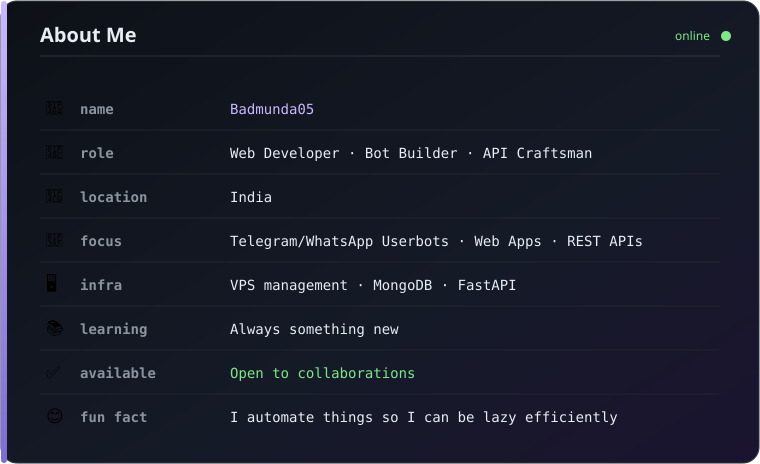

 

 

<table align="center">
<tr>
<td width="70%" valign="top">

</td>
<td width="30%" valign="top" align="center">

</td>
</tr>
</table>

---

### 🛠️ Tech Stack

 

**Languages**
 

**Frontend**
 

**Backend & APIs**
 

**Bots & Userbots**
 

**Tools & Infra**
 

---

### 📊 GitHub Stats

 

 

### 🏆 Trophies

---

### 🔥 Activity Graph

---

### 🤖 What I Build

| Type | What |
|:---:|:---|
| 🌐 **Web Apps** | Full-stack apps with clean UI and fast backends |
| 🤖 **Telegram Bots & Userbots** | Automation bots, info bots, userbots, utility tools |
| 💬 **WhatsApp Userbots** | Self-bots & automation on WhatsApp |
| ⚡ **REST APIs** | Scalable APIs with proper auth & documentation |
| 🖥️ **VPS & Deployment** | Setting up, securing and running bots/apps on a VPS |

---

### 📫 Get in Touch

---

*"First, solve the problem. Then, write the code."*

